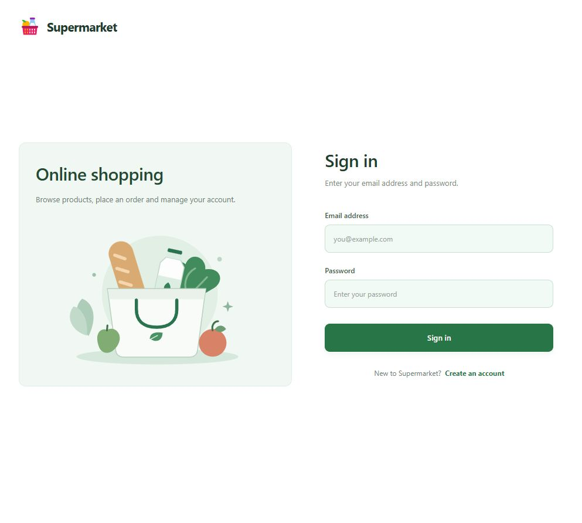
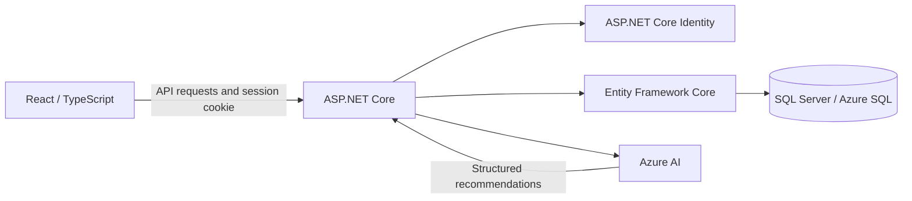

# Supermarket

A graduate full-stack portfolio project combining customer shopping with a supermarket management dashboard.

**React + TypeScript · ASP.NET Core 10 · EF Core · SQL Server · Azure AI**



## Features

- **Customer:** registration/sign-in, product search and quantities, basket, simulated checkout and personal order history.
- **Administrator:** product/category/manufacturer maintenance, customer lookup and order review, sales charts and low-stock information.
- **Shopping assistant:** current product recommendations and budget-based shopping lists, editable quantities and basket integration.
- **Interface:** responsive supermarket theme, keyboard search and visible Save state for unsaved product edits.

Checkout is simulated; no money is collected.

**Azure deployment target:** [Supermarket](https://supermarket-api-ll-ghgbdth2hsaqc3bh.denmarkeast-01.azurewebsites.net/).
Updates reach this site through the main-branch deployment workflow. See [Azure setup](docs/azure-deployment.md).

Customers can register an account. Shared administrator credentials are not included in the repository.

## Architecture



Vite proxies `/api` to `localhost:5252` during development. In Azure, the frontend build is served from the API's `wwwroot`, keeping frontend and API on one origin.

Checkout requests contain product IDs and quantities. The API reads trusted prices/stock, deducts inventory and saves order lines in a Serializable SQL transaction. Order lines retain purchase-time names and prices.

Identity handles passwords and session cookies. API role guards protect operations; personal order queries use the authenticated user's identity. Frontend route checks improve navigation but do not replace backend authorization.

AI output is untrusted. The backend filters unknown products, caps quantities to stock, rebuilds totals and checks the model-provided budget. User-edited lists recalculate prices in the interface; checkout performs the final trusted price/stock check.

## Run locally

Requirements: Node.js **22.16+**, **.NET 10 SDK**, SQL Server **2022** or Azure SQL. Docker Compose can run the provided development database.

1. Set `MSSQL_SA_PASSWORD` in a local `.env` and run `docker compose up -d sqlserver`, or use an existing SQL Server. Keep credentials outside Git.
2. Set the API connection, replacing the example values:

   ```powershell
   dotnet user-secrets set "ConnectionStrings:DefaultConnection" "Server=localhost,1433;Database=SupermarketDb;User Id=sa;Password=YOUR_LOCAL_PASSWORD;TrustServerCertificate=True" --project backend/Supermarket.Api
   ```

3. Install the matching EF CLI if needed and apply migrations:

   ```powershell
   dotnet tool install --global dotnet-ef --version 10.0.13
   dotnet ef database update --project backend/Supermarket.Api
   ```

4. Start the API:

   ```powershell
   dotnet run --project backend/Supermarket.Api --launch-profile http
   ```

5. In another terminal:

   ```powershell
   cd frontend
   npm ci
   npm run dev
   ```

Open [localhost:5173](http://localhost:5173). Check API/database readiness at [localhost:5252/health/ready](http://localhost:5252/health/ready).

The initializer creates `Admin` and `User` roles after the database is ready. It does not apply schema migrations or automatically create an administrator.

### Optional AI configuration

Set these backend user secrets or environment variables:

| Configuration key | Environment variable |
| --- | --- |
| `AzureAI:Endpoint` | `AzureAI__Endpoint` |
| `AzureAI:DeploymentName` | `AzureAI__DeploymentName` |
| `AzureAI:ApiKey` | `AzureAI__ApiKey` |

Never put the API key in a frontend `VITE_` variable. Without these settings, shopping/management work and assistant requests show a failure message.

## Test and build

```powershell
cd frontend
npm test
npm run lint
npm run build
```

`npm test` runs Node cart/API tests in `frontend/test/` followed by Vitest component tests in `frontend/src/test/`.

From the repository root:

```powershell
dotnet test backend/Supermarket.Api.Tests/Supermarket.Api.Tests.csproj --configuration Release
```

Release tests use different output files from the normal Debug development server. If Windows still reports a locked build file, stop the local API before rerunning the tests.

Tests cover cart limits, logout, order errors, dashboard states, AI quantity editing, order ownership, statistics, invalid checkout input and HTTP role authorization. Most backend tests use InMemory and do not prove SQL transaction/concurrency behavior.

GitHub Actions builds/tests the frontend/backend and smoke-tests the published app on PRs and main pushes. Only main outside a PR can deploy. Azure credentials, database networking and migrations still need to be configured.

## Repository map

| Path | Purpose |
| --- | --- |
| `frontend/src/pages/` | Authentication, management, dashboard and shopping |
| `frontend/src/components/` | Forms, tables, dialogs and AI chat |
| `frontend/src/api/` | Browser-to-API requests |
| `backend/Supermarket.Api/Controllers/` | HTTP endpoints and authorization |
| `backend/Supermarket.Api/Data/` | EF context and role initialization |
| `backend/Supermarket.Api/Services/` | Azure AI client |
| `backend/Supermarket.Api/Migrations/` | Versioned database schema |
| `backend/Supermarket.Api.Tests/` | xUnit behavior/authorization tests |
| `tests/smoke.mjs` | Published website checks with an unavailable database |

## Current boundaries

- Payment is simulated; payment-provider/refund integration is outside scope.
- Basket and chat messages live in React state and reset on refresh.
- AI requests send the current message and at most 100 in-stock products, without persistent conversation history.
- Checkout has no idempotency key. An uncertain response must not be blindly retried as another purchase.
- Real SQL concurrency, deadlock/retry behavior and load require dedicated verification.
- Shared public admin access and AI usage quotas are not implemented.
